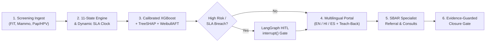

<div align="center">

# 🩺 CareLoop AI — Closing the Screening-to-Care Loop

**Explainable Clinical Decision Support, Dynamic Risk Triage & Human-in-the-Loop Governance for Timely Cancer Screening Follow-Ups**

[](https://careloop-ai-livid.vercel.app)
[](https://careloop-ai-a71u.onrender.com/healthz)
[](https://careloop-ai-a71u.onrender.com/docs)
[](LICENSE)

[](apps/api/pyproject.toml)
[](apps/web/package.json)
[](ml/train)
[](apps/api/app/graph)
[](apps/api/app/db)

</div>

> **Clinical Safety & Synthetic Data Notice:** CareLoop AI is an assistive clinical coordination and decision-support platform operating exclusively on **100% synthetic patient records**. It never diagnoses conditions, never prescribes medications, and never closes or escalates urgent cases without documented diagnostic evidence or authorized human clinical sign-off.

---

## 🌐 Live Demo & Verification Links

| Service | URL | Description |
| :--- | :--- | :--- |
| **Web Application** | [**careloop-ai-livid.vercel.app**](https://careloop-ai-livid.vercel.app) | Full interactive UI with 8-step Guided Tour & Sandbox Clock |
| **Patient Portal Demo** | [**.../p/pt-seed-001**](https://careloop-ai-livid.vercel.app/p/pt-seed-001) | Multilingual (`EN` / `HI` / `ES`) patient tracker & Teach-Back quiz |
| **Backend REST API** | [**careloop-ai-a71u.onrender.com/docs**](https://careloop-ai-a71u.onrender.com/docs) | Interactive OpenAPI / Swagger documentation |
| **System Health Check** | [**.../healthz**](https://careloop-ai-a71u.onrender.com/healthz) | Live FastAPI + PostgreSQL database connectivity status |

---

## 📌 The Clinical Problem & Our Solution

Between **25% and 40%** of patients with abnormal cancer screening results (**FIT**, **Mammography**, **Pap/HPV**) fail to complete timely diagnostic follow-ups. Care coordinators are overwhelmed by unprioritized First-In-First-Out (FIFO) queues, patients drop off due to medical jargon, fear, or logistical barriers (transport/insurance), and referrals get lost between primary care and specialists.

**CareLoop AI** replaces passive tracking with an end-to-end, closed-loop coordination system:

1. **Deterministic 11-State Lifecycle (`R1`):** Tracks every abnormal screening from issuance to verified closure in an immutable, append-only ledger (`case_events`)—zero silent drops.
2. **Dynamic Priority Queue & SLA Clocks (`R2`):** Ranks cases using urgency tier, calibrated drop-off probability ($P_{\text{drop}}$), and SLA pressure. Urgent Tier-1 cases automatically halve SLA windows (e.g., 72h vs. 14d).
3. **Multilingual Patient Portal & Teach-Back (`R3`):** Frictionless, token-authenticated portal in **English**, **Hindi (`हिंदी`)**, and **Spanish (`Español`)** with interactive comprehension verification that auto-escalates confused or barrier-blocked patients.
4. **Cross-Provider SBAR Referrals & Consults (`R4`):** Structured Situation-Background-Assessment-Recommendation hand-offs with standardized `ReasonCode` rejections and bi-directional consult threads.
5. **Human-in-the-Loop & Closure Gate (`R5`):** High-risk cases ($P_{\text{drop}} > 0.65$), urgent SLA breaches, or confused teach-back responses pause at a checkpointed **LangGraph `interrupt()`** gate requiring human clinician sign-off. Cases cannot close without verified diagnostic evidence or documented clinician override.
6. **Impact Metrics & Queue Simulation (`R6`):** Live turnaround KPIs and a 100-run Monte Carlo simulation comparing legacy FIFO outreach against CareLoop dynamic prioritization.

---

## 🏗️ System Architecture



---

## 🧠 Machine Learning, Explainability & Safety Audits

All models are trained and evaluated on a **12,000-patient synthetic clinical cohort** (`7,200` train / `1,800` calibration / `3,000` test; `73,811` stage rows) generated via [`ml/data/generate.py`](ml/data/generate.py). Total artifact footprint is **1.44 MB** (`xgb.joblib` is **263 KB**), running CPU-only inference in **<15 ms**.

| Component | Architecture / Method | Key Verified Metrics |
| :--- | :--- | :--- |
| **Drop-Off Risk Classifier** | Isotonic-Calibrated XGBoost | **ECE = `0.0097`**, Brier = `0.1848`, ROC-AUC = `0.6403` *(Bayes-optimal ceiling ~0.65 under unmanipulated `noise_std=0.92`)* |
| **Time-to-Closure Survival** | `WeibullAFTFitter` *(auto-fallback on PH violation)* | **Concordance Index = `0.6818`**, Kaplan-Meier $S(t)$ curve over 120-day horizon |
| **Explainable AI (XAI)** | TreeSHAP Log-Odds Waterfall | **20-Bootstrap Spearman $\rho = 0.9964$**, Top-3 feature overlap = `100%` |
| **LLM Clinical Faithfulness** | Fact-Grounded Summaries + ADS Audit (`qwen/qwen3.8-27b`) | **Mean ADS = `0.0`**, Validator Pass Rate = **`100%`** (`600` generations across `200` cases) |
| **Queue Impact Simulation** | 100-Run Stochastic Monte Carlo | CareLoop Median = **`33.67d`** (Day-60 Unresolved: **`8.67%`**) vs. FIFO Median = **`36.50d`** (Day-60 Unresolved: **`12.52%`**) |

---

## 🛠️ Tech Stack

| Layer | Technologies |
| :--- | :--- |
| **Frontend** | Next.js `15.5`, React `19.1`, TypeScript `5`, Tailwind CSS `4`, TanStack React Query `5`, Recharts `3`, Lucide Icons |
| **Backend API** | FastAPI `0.115+`, Python `3.11`, Pydantic v2, SQLAlchemy `2.0`, Alembic, SlowAPI rate limiting, Uvicorn |
| **Agentic Governance** | LangGraph `0.2+` with Postgres / SQLite checkpointed human-in-the-loop `interrupt()` workflows |
| **Database** | Supabase PostgreSQL (production) / SQLite (local fallback), append-only `case_events` audit ledger |
| **ML & Biostatistics** | XGBoost `2.1`, Scikit-learn `1.5`, SHAP `0.46`, Lifelines `0.29` (`WeibullAFTFitter`), Joblib |
| **Quality & CI/CD** | `pytest`, `ruff`, `mypy --strict`, `eslint`, `tsc --noEmit`, Playwright E2E, GitHub Actions |

---

## 📁 Repository Structure

```text
Careloop-AI/
├── apps/
│   ├── api/                        # FastAPI Backend & LangGraph Orchestration
│   │   ├── alembic/                # Database migrations
│   │   ├── app/
│   │   │   ├── core/               # Config, caching, security & rate limiting
│   │   │   ├── db/                 # SQLAlchemy models & repository layer
│   │   │   ├── domain/             # Pure 11-state engine, SLA & metrics logic
│   │   │   ├── graph/              # LangGraph HITL interrupt() workflow
│   │   │   ├── llm/                # Groq clinical assistant & ADS faithfulness validator
│   │   │   ├── routers/            # REST endpoints (cases, screenings, referrals, metrics, patient, demo)
│   │   │   └── services/           # ML inference & survival scoring
│   │   └── tests/                  # Pytest unit, integration, domain, graph, LLM & ML suites
│   └── web/                        # Next.js 15 Frontend Application
│       ├── src/app/
│       │   ├── page.tsx            # Public Landing Page & R1–R6 Overview
│       │   ├── app/                # Authenticated Workspace (Queue, Cases, Approvals, Clinician, Metrics, Model Card)
│       │   └── p/[token]/          # Multilingual Patient Portal (EN / HI / ES + Teach-Back)
│       └── src/components/         # Recharts SHAP waterfall, survival curves, lifecycle stepper
├── ml/
│   ├── artifacts/                  # Trained models (xgb.joblib, calibrator.joblib, cox.joblib, metrics.json, seed.json)
│   ├── data/                       # 12,000-patient synthetic cohort generator
│   ├── eval/                       # Fairness, SHAP stability, LLM faithfulness & queue simulation audits
│   └── train/                      # Training & calibration pipelines
├── docs/                           # Architecture, Model Card, Data Card & R1–R6 Traceability
├── .github/workflows/              # CI pipeline & Render keepalive cron
├── render.yaml                     # Render deployment blueprint
└── WEBSITE_NAVIGATION_AND_FEATURE_GUIDE.md
```

---

## 🚀 Quick Start (Local Development)

> **Zero External API Keys Required:** Local development runs out of the box with deterministic fallbacks and an isolated synthetic sandbox.

### 1. Start the FastAPI Backend (`http://localhost:7860`)
```powershell
cd apps/api
uv sync
uv run alembic upgrade head
uv run uvicorn app.main:app --host 127.0.0.1 --port 7860 --reload
```

### 2. Start the Next.js Frontend (`http://localhost:3000`)
```powershell
cd apps/web
npm install
npm run dev
```

Open **[http://localhost:3000](http://localhost:3000)** and click **Launch Live Demo** to provision an isolated 60-case synthetic sandbox and walk through the **8-Step Guided Tour**.

---

## 🧪 Running Tests, Linters & ML Audits

### Backend Verification (`pytest`, `ruff`, `mypy --strict`)
```powershell
cd apps/api
uv run ruff check .
uv run mypy app
uv run pytest -q
```

### Frontend Verification (`eslint`, `tsc`, `build`, Playwright E2E)
```powershell
cd apps/web
npm run lint
npm run typecheck
npm run build
npx playwright test
```

### Re-running Data Generation, Model Training & M11 Audits
```powershell
# PowerShell (set PYTHONPATH to repo root and apps/api)
$env:PYTHONPATH="$PWD;$PWD\apps\api"
cd apps/api
uv run python -m ml.data.generate
uv run python -m ml.train.evaluate
uv run python -m ml.eval.fairness
uv run python -m ml.eval.shap_stability
uv run python -m ml.eval.llm_faithfulness
uv run python -m ml.eval.simulate_queue
```

---

## 📚 Documentation Index

- [`WEBSITE_NAVIGATION_AND_FEATURE_GUIDE.md`](WEBSITE_NAVIGATION_AND_FEATURE_GUIDE.md) — Step-by-step walkthrough of every page, button, chart, and workflow.
- [`docs/architecture.md`](docs/architecture.md) — System architecture, domain invariants, and clinical guidelines consulted.
- [`docs/model-card.md`](docs/model-card.md) — Honest test-split metrics, calibration ECE/Brier, WeibullAFT survival C-index, SHAP stability, and fairness audits.
- [`docs/data-card.md`](docs/data-card.md) — 12,000-patient synthetic cohort schema, generative coefficients, and leakage checks.
- [`docs/TRACEABILITY.md`](docs/TRACEABILITY.md) — End-to-end R1–R6 traceability matrix across domain, API, UI, and tests.
- [`DECISIONS.md`](DECISIONS.md) — Conservative engineering decisions logged during implementation.

---

## 📄 License & Author

Developed by **Prafullit Bhattacharya** — released under the [MIT License](LICENSE).
